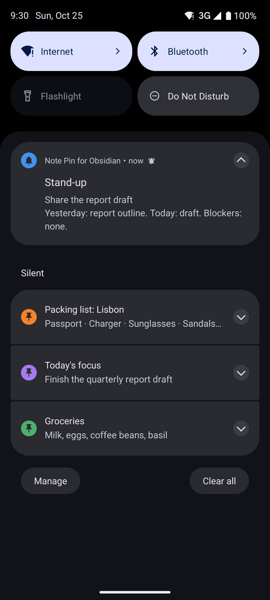
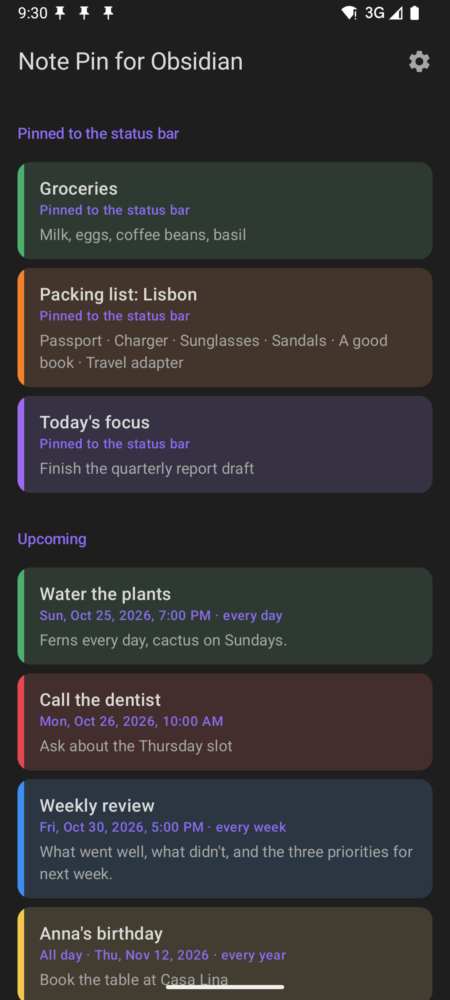
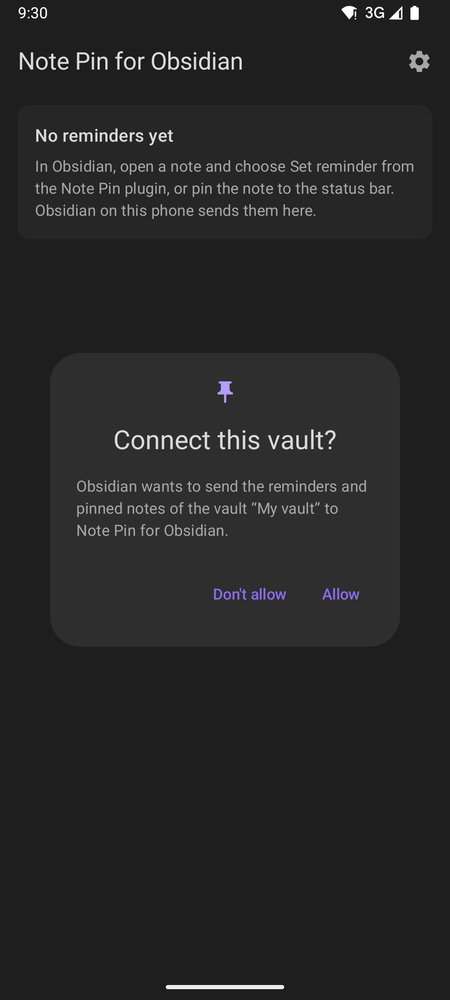

# Note Pin for Obsidian


Note Pin for Obsidian puts your Obsidian notes in Android's notification bar and makes their reminders go off on time. It's the companion app for [**Note Pin**](https://community.obsidian.md/plugins/vladmas-note-pin), an Obsidian plugin: you set reminders and pins in Obsidian, and this app shows them.

It's an unofficial app, not made by the Obsidian team.

<a href="https://play.google.com/store/apps/details?id=com.vladmas.notepinobsidian"></a>
<a href="https://f-droid.org/packages/com.vladmas.notepinobsidian/"></a>

Or download the APK from [GitHub Releases](https://github.com/TODO-owner/TODO-app-repo/releases/latest).

| Pinned notes and a reminder | The app | Connecting a vault |
|---|---|---|
|  |  |  |

## Highlights

- **Pins notes to the notification bar.** A pinned note shows its title and first lines, in the note's color, until you unpin it in Obsidian. Keep a shopping list, today's plan or a packing list one swipe away. Tap it and the note opens in Obsidian.
- **Reminders that go off on time:**
  - at a set time, or all day. An all-day reminder alerts once, then stays in the notification bar until midnight, unless you remove it;
  - one-off, or repeating every day, every week or every 2 weeks, every month on a date or a weekday (such as the third Sunday), or every year, also by the Chinese lunar calendar, until an end date if you set one;
  - exact alarms, so they go off at the minute you set, even when Obsidian is closed.
- **Works offline, with no external services.** No account, no server, no ads, no analytics, and no internet permission at all.
- **Lists everything** pinned or coming up, with past reminders below. Tap one to open the note.
- **Puts pins and alarms back by itself** after the phone restarts, the time zone changes, or the app updates.
- **Setup that knows your phone.** It checks the permissions reminders need and that battery use is unrestricted, and shows what the phone's maker adds on top:
  - Autostart on Xiaomi, POCO and Redmi;
  - Never auto sleeping apps on Samsung;
  - App launch on Huawei and Honor;
  - background settings on OPPO, OnePlus, realme and vivo.
- **Pins that can't be swiped away.** On Android 14 and later, Setup has a test notification that shows whether pins can be swiped away, and how to stop it ([below](#optional-pins-that-cant-be-swiped-away-android-14)).
- **In English, Russian and Georgian.** It follows the phone's language. On Android 13 and later, you can also pick a language for this app alone in its App info.

## Works offline, with no external services

- The app has **no internet permission**, so Android won't let it go online.
- There's no account, no server, no ads and no analytics.
- Obsidian on the phone hands your reminders straight to the app, and the app tells Obsidian they arrived intact.
- A vault can only send reminders after you allow it, so other apps can't pose as Obsidian.
- Your reminders live in your notes' properties, so they sync with whatever you already use for your vault.

## Phone and computer

You can set reminders and pins in Obsidian on any device. Your vault's sync brings them to the phone, and the next time Obsidian opens there, it hands them to this app. Obsidian on a computer shows reminders as desktop notifications while it's open. The [plugin's page](https://community.obsidian.md/plugins/vladmas-note-pin) compares desktop and Android.

## Getting started

1. **Get the app** from one of these. It needs Android 8 or later.
   - [Google Play](https://play.google.com/store/apps/details?id=com.vladmas.notepinobsidian), which keeps it up to date.
   - [F-Droid](https://f-droid.org/packages/com.vladmas.notepinobsidian/), which keeps it up to date too.
   - [GitHub Releases](https://github.com/TODO-owner/TODO-app-repo/releases/latest): download the `.apk` file under **Assets** and open it on the phone. The app can't check for new versions itself, since it has no internet access. Download each new release yourself, or let an app such as Obtainium watch for them.
2. **Open it and go through Setup.** Make sure battery use is unrestricted (below).
3. **Install the [Note Pin plugin](https://community.obsidian.md/plugins/vladmas-note-pin)** in your vault, and open Obsidian on the phone. The first time the plugin sends your reminders, the app asks whether to allow the vault.

All three are built from the same code. They may be signed with different keys, though, and Android won't update an app with a copy signed with another key. To switch to another source, uninstall the app first, install it from the new place, and allow your vault again when the app asks.

### Set battery use to unrestricted

Android, and many phone makers on top of it, can hold back an app whose battery use they restrict. A reminder can then wait until you next open the app instead of going off on time. Setup checks this for you:

1. Open **Note Pin for Obsidian**. Setup opens the first time. After that, it's in **Settings → Setup and permissions**.
2. Look at the **Battery** card. If it has a green check and says "Battery use is unrestricted", you're done.
3. Otherwise, tap the card's button and choose the unrestricted option:
   - **Xiaomi, POCO and Redmi:** **App info** → Battery usage → set Battery saver to **No restrictions**.
   - **Samsung:** **App info** → Battery → **Unrestricted**.
   - **Other phones:** **Battery settings** opens Android's battery optimization list. Show all apps, pick Note Pin for Obsidian, and choose **Don't optimize** (on some phones it's called **Unrestricted**).
4. Come back to the app. The card turns green.

Below it, the **This phone** card lists the settings your phone's maker adds, such as **Autostart** on Xiaomi phones. Turn those on too. If a setting needs your attention later, the app's main screen shows a **Finish setting up** card.

### Optional: pins that can't be swiped away (Android 14+)

From Android 14, you can swipe away any notification, pinned notes included. Opening the app brings them back. To make pins stay put, run this command once, from a computer with USB debugging turned on, or on the phone with Shizuku or LADB:

```
adb shell appops set --uid com.vladmas.notepinobsidian SYSTEM_EXEMPT_FROM_DISMISSIBLE_NOTIFICATIONS allow
```

Setup shows the same command with a Copy button, and a test notification to check that it worked.

## Development

This part is for building the app yourself.

### Build

On Windows, in PowerShell, with the JDK that comes with Android Studio:

```
$env:JAVA_HOME = "C:\Program Files\Android\Android Studio\jbr"
.\gradlew.bat assembleDebug testDebugUnitTest
```

On macOS or Linux, run `./gradlew assembleDebug testDebugUnitTest`.

- The debug APK is in `app/build/outputs/apk/debug/`. Install it with `adb install app/build/outputs/apk/debug/app-debug.apk`.
- `assembleRelease` builds a minified APK of about 1 MB, and `bundleRelease` the app bundle Google Play takes. Both need a signing key.
- The version is `versionCode` and `versionName` in `app/build.gradle.kts`.

### Tests

The unit tests are in `app/src/test`. `ScheduleTest` checks the repeat rules against `app/src/test/resources/recurrence-cases.json`, and the Chinese lunar calendar against every month start the Hong Kong Observatory publishes for 1901–2100, in `chinese-months.json` next to it. The plugin's tests use identical copies of both files, so the app and the plugin work out the same dates, and a change to one belongs in both repositories. The plugin's `scripts/build_lunar_table.py` rebuilds the lunar table.

### How the app and the plugin talk

- The plugin opens a `vladmas-note-pin://sync?v=1&vault=…&req=…&token=…&data=…` link. `data` is the vault's pinned notes and reminders, as base64url JSON.
- The app answers by opening `obsidian://vladmas-note-pin?op=ack&req=…&len=…&crc=…`, so the plugin can check the message arrived intact. The answer also lists the reminders the app showed on time.
- A vault that isn't allowed yet goes to `PairActivity` first. Once allowed, the app keeps the vault's token, so other apps can't pose as Obsidian.
- The ADB command above grants the `SYSTEM_EXEMPT_FROM_DISMISSIBLE_NOTIFICATIONS` app op, which lets the app post notifications with Android's no-dismiss flag.

### Store listing

The store texts and images are in [`fastlane/metadata/android/en-US`](fastlane/metadata/android/en-US), in the layout F-Droid and fastlane read:

- the title;
- the short and full descriptions;
- the 512 px icon and the feature graphic;
- the phone screenshots.

Russian and Georgian texts are in `ru-RU` and `ka-GE`. The icon's source drawings are in [`art/`](art).

## About

Note Pin for Obsidian is open source, under the [MIT license](LICENSE).

Made by [vladmas](https://vladmas.com). If you like the app, you can support me on Ko-fi:

[](https://ko-fi.com/vladmas)

<sub>Google Play and the Google Play logo are trademarks of Google LLC.</sub>
